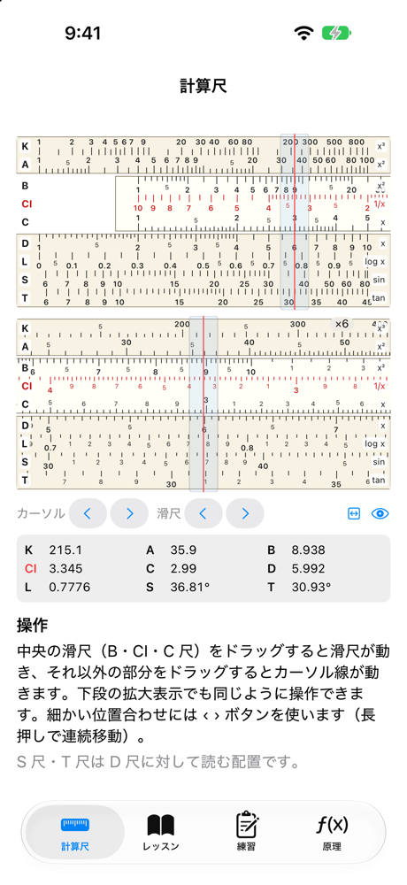
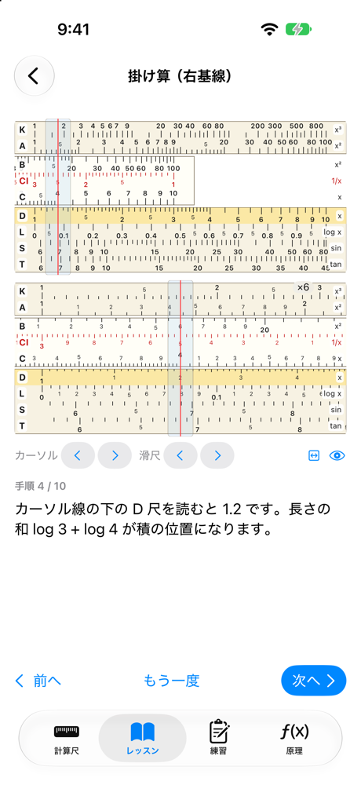
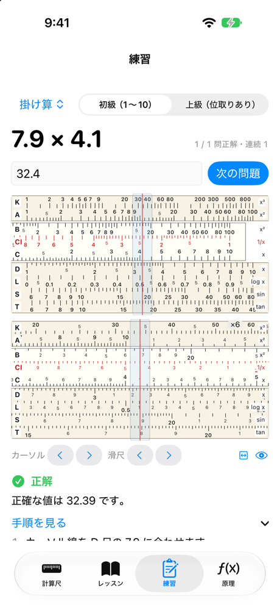
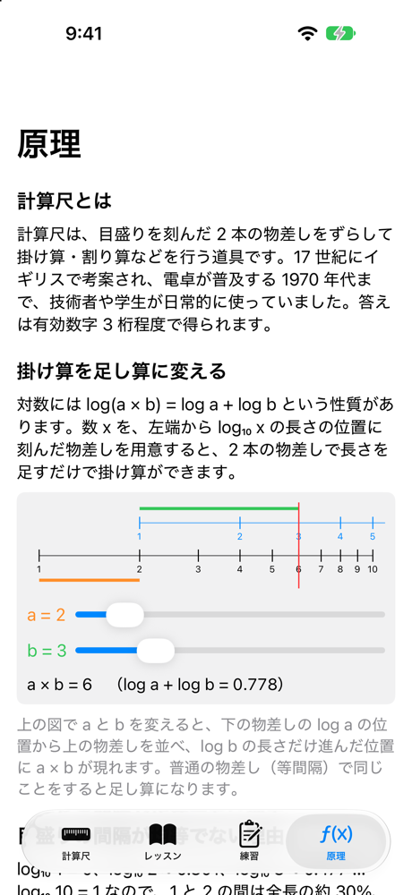

# 計算尺道場（slide_rule）

計算尺の使い方を学ぶための iOS / macOS アプリ（SwiftUI）。

| 計算尺 | レッスン | 練習 | 原理 |
| :---: | :---: | :---: | :---: |
|  |  |  |  |

## 機能

- **計算尺**：K・A・B・CI・C・D・L・S・T 尺を備えた計算尺をドラッグで操作する。滑尺部分をドラッグすると滑尺、それ以外はカーソルが動く。拡大表示（×3〜×16）と微調整ボタン付き
- **レッスン**：目盛りの読み方、掛け算（左基線・右基線）、割り算、逆数、2 乗・平方根、3 乗・立方根、常用対数、三角関数、位取りの 9 レッスン。手順ごとに計算尺が自動で動く
- **練習**：10 種類の問題をランダムに出題し、入力した答えを採点する（相対誤差 0.5% 以内で正解、桁違いは個別に指摘）
- **原理**：対数で掛け算が足し算になる仕組みを図で解説

S 尺・T 尺は D 尺に対して読む配置にしている（D 尺の読み ÷ 10 が sin・tan）。

## ダウンロード

macOS 版は [Releases](https://github.com/Masakai/slide_rule/releases) から、最新の `SlideRule-x.y.z.zip` をダウンロードして展開し、`SlideRule.app` を開く。macOS 15 以降が必要で、Apple Silicon と Intel の Mac で動く。Developer ID で署名し、Apple の公証を受けているので、警告なしに開ける。

iOS 版は配布していない。下の手順でソースからビルドする。

## 構成

```
App/                         SwiftUI の画面（iOS / macOS 共通）
Packages/SlideRuleKit/       尺の写像・目盛り生成・操作手順・採点などのロジック（UI 非依存）
project.yml                  XcodeGen の設定
```

`SlideRule.xcodeproj` は生成物なので git 管理していない。

## ビルド

```bash
brew install xcodegen   # 未導入の場合
cp Local.xcconfig.example Local.xcconfig   # 実機で動かす場合。DEVELOPMENT_TEAM を自分のチーム ID にする
xcodegen generate
open SlideRule.xcodeproj
```

署名のチームは git 管理外の `Local.xcconfig` に書き、`Base.xcconfig` から読み込む。

## macOS 版の配布（署名・公証）

```bash
Tools/notarize_mac.sh 0.1.0
```

Release ビルド（universal）を Developer ID で署名し、公証・staple・`syspolicy_check` まで行って `dist/SlideRule-0.1.0.zip` を作る。`Local.xcconfig` に `DEVELOPMENT_TEAM` と `MAC_SIGN_IDENTITY`（Developer ID Application 証明書の SHA-1）を書いておく。公証には Keychain のプロファイル `notarytool-password` を使う。

## テスト

```bash
cd Packages/SlideRuleKit && swift test
```

レッスン・練習問題の各手順で、カーソル線の下に正しい値が読めることを検証している。

## ライセンス

[MIT License](LICENSE)
